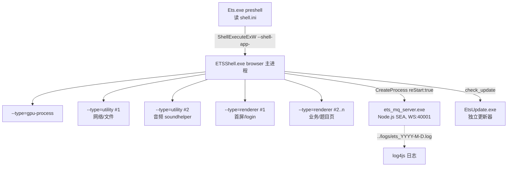

# E听说 PC 学生端 · 07 壳层 / 更新 / 音频转码链

> 目标目录：`D:\ets-rea\ETS`（只读，未做任何修改）。分析日期：2026-11-06。
> 本文只覆盖**壳层与周边组件**：启动链、进程模型、`shell.ini`、`stic://` 自定义协议、窗口控制桥、更新链路、崩溃上报、缓存清理、音频转码链。
> 证据等级沿用总览约定：**【观察】**=文件字节/日志原文/工具输出；**【推断】**=由观察推理，附推理链；**【未知】**=证据不足，汇总在 §11。
> PII 已脱敏：用户名、手机号、账号、JWT、机器名、GUID 中的账号相关值均以 `<user>`/`<redacted>` 代替。

---

## 1. 结论摘要

1. **启动链是两段式**：`Ets.exe`（485,824 B，PDB 显示 `preshell`）读取 `shell.ini`，用 `ShellExecuteExW` 拉起 `shell.ini` 里 `AppName=ETSShell.exe`；`ETSShell.exe`（2,297,440 B，STIC V3.0.76）初始化 CEF 91 并创建主窗口。**【观察 + 推断】**
2. **进程模型是标准 CEF 多进程**：1 个 browser 主进程（`processName` 为空）+ `--type=gpu-process` + 2×`--type=utility` + 1~3×`--type=renderer`；另有 Node.js SEA 进程 `ets_mq_server.exe`（12,080,168 B）作为 WebSocket 广播总线（端口 40001，`packages\app.json`）。**【观察】**
3. **外壳自己有一套自定义协议 `stic://`**，注册了 4 个 host：`shell.iflytek.com`、`file.iflytek.com`、`rpk.iflytek.com`、`cpk.iflytek.com`；`file.iflytek.com` 的 URL 直接映射到本机绝对路径（`stic://file.iflytek.com/C:\Users\<user>\AppData\Roaming\ETS\<set>\...`）。**【观察】**
4. **窗口控制是「JS 桥 + 原生插件」**：`packages\default\appcontroller.js` 定义 14 个 action（`init/close/maximize/minimize/restore/move/fullscreen/reduction/hide/show/get_win_pos/set_win_pos/startapp/idg_exist`），经 `cef.message.sendMessage(<callbackId>, 'appcontroller', <action>, <json>)` 调用原生 `appcontroller.pln`；`win_x/win_y = -1` 表示居中。**【观察】**
5. **更新器是独立 EXE**：`EtsUpdate.exe`（根目录与 `temp\EtsUpdate.exe` **同 hash**），用 glog 写 `temp\update\log\INFO_uLOG_<date-time>.<pid>`；请求 `client/mobile-update`（`http://api.ets100.com`），比较 `Update_Version`（整数 5079）与服务器 `client_version`，相等即「不需要更新」并以**退出码 1** 退出。下载/安装/回滚/重启的能力面由字符串与 PE 导入完整还原（§6）。**【观察 + 推断】**
6. **音频链是「原生录音 → mp3 + speex + 评测 xml → OSS 上传」**：`soundhelper.pln` 录音产出 `soundfiles\public_<32hex>_<epochms>.mp3` + 同名 `.mp3.spx` + 同名 `.xml`（iFlytek ISE 评测结果），三个文件都上传到 `https://ets60.oss-cn-hangzhou.aliyuncs.com`。系统另带 `lame.exe`（LAME 3.100）、`ffmpeg\ffmpeg.exe`（libavformat 58.42.101 ≈ FFmpeg 4.2.x）与 `process_ori.bat` 视频混音脚本、`7z.dll` + 7-Zip 解压链。**【观察 + 推断】**

---

## 2. 启动链与进程模型

### 2.1 两层启动链

| 层 | 程序 | 关键证据 | 作用 |
|---|---|---|---|
| L0 | `Ets.exe` | `preshell.pdb`（`D:\code\STIC\preshell_2\Release\preshell.pdb`）、字符串 `.\shell.ini`、`ShellConfig`、`AppName`、`shell.exe`、`--shell-app-`、导入 `ShellExecuteExW` / `GetCommandLineW` / `ShellExecuteExW` | 读 `shell.ini` → 取 `[ShellConfig] AppName` → 拉起壳程序 |
| L1 | `ETSShell.exe` | 字符串 `ETSShell.exe`、`D:\code\STIC\stic-pro_ets\_bin\ETSShell.pdb`、`shell::main`、`shell.cpp` 日志、`cef_initialize` / `cef_execute_process` / `cef_register_scheme_handler_factory` | STIC 壳：CEF 初始化、窗口/托盘、插件加载、JS 桥、日志、更新检查 |
| L2 | CEF 子进程 | `shell.cpp(56)` 的 `processName`：`--type=gpu-process`、`--type=utility`、`--type=renderer`；`--type=` 字符串 | GPU / 网络 / 音频 / 渲染 |
| L2' | `ets_mq_server.exe` | `shellhelper.cpp(806/902)`（`reStart: true`、`processexist`）、`mq_server\main.js`、`mq_server\package.json`（`ws`） | Node.js WebSocket 广播总线（悬浮球/多窗口同步） |

**【推断】L0→L1 的传参**：`Ets.exe` 把自身命令行加上 `--shell-app-` 前缀传给 `ETSShell.exe`（`--shell-app-` 是该 EXE 内独立字符串，且 `ETSShell.exe` 解析命令行时使用 `CommandLineToArgvW`）。日志中 `processName` 为空的主进程即 `ETSShell.exe` 本身，因此壳层日志**不包含**完整 argv。

`Ets.exe` 还带 `ShellConfig`、`shell.exe` 字符串；`ETSShell.exe` 内也有 `eshell.ini`、`shell.exe`，说明存在**备用/兼容配置文件与进程名**。**【推断】**

### 2.2 ETSShell 内部启动时序（三次启动完全一致）

以 `logs\shell_2026-11-4.log` 第一会话（11-04 19:22:55）为例：

| 时间 | 事件 | 证据 |
|---|---|---|
| 19:22:55 | 主进程 banner，`【shell::main】processName:` （空） | `shell.cpp(468-471)`, `shell.cpp(56)` |
| 19:22:55 | GPU 进程拉起 | `shell.cpp(56)` |
| 19:22:55 | `StiAdapter::CreateMainBrowser` 成功；`RunMessageLoop` 开启 CefMessageLoop | `StiAdapter.cpp(105/133)` |
| 19:22:56 | utility ×2、renderer 拉起；插件 banner | `shell.cpp(56)`, `StiCorePlugin.h(137-141)` |
| 19:22:56 | 首个 action：`shellhelper/getconfig` | `shellhelper.cpp(32)` |
| 19:22:56 | `appcontroller/SetWinPos` 780×480，居中，`device scale: 1` | `appcontroller.cpp(150/170/190)` |
| 19:22:57 | 插件 init：`shellhelper` → `httphelper` → `filehelper` → `etshelper`×2 | 各插件 cpp |
| 19:22:57 | 环境探测：`existfileorfolder(ets_mq_server.exe)`、`get_appdata_path`、`getvolume` | `filehelper.cpp(416)`, `etshelper.cpp(534)` |
| 19:22:57 | `processexist: ets_mq_server.exe` | `shellhelper.cpp(902)` |
| 19:22:58 | `getpcinfo`；`getWpsVersion` 失败（未装 WPS） | `shellhelper.cpp(32)`, `shell_utils.cpp(1222)` |
| 19:22:58 | `startprocess` → `reStart: true`（启动 mq_server） | `shellhelper.cpp(806)` |
| 19:22:58 | `encode_api_body_v2` ×3 | `etshelper.cpp(499)` |
| 19:22:59 | `check_update` → `UpdateAPI.cpp(78)` 打开 `localdata\Ets.db` | `etshelper.cpp(522)`, `UpdateAPI.cpp(78)` |
| 19:22:59 | 缓存清理：`getmd5(clear_cache.zip)` 缺失 → 下载 → 解压 ×2 → `executecmd` | `filehelper.cpp`, `httphelper.cpp`, `sevenzip.cpp` |
| 19:23:00 | `get_win_pos` → `SetWinPos` 900×600 @(510,240) | `appcontroller.cpp(466/150/170/190)` |
| 19:23:05 | 第 2 个 renderer（业务页） | `shell.cpp(56)` |

完整逐秒时间线见 `work/pkg/shell_timeline.md`。

### 2.3 CEF 子进程与命令行开关

日志里只记录 `--type=` 这一段；完整开关来自 `ETSShell.exe` 内嵌字符串**【观察】**：

| 开关 / 资源 | 说明 |
|---|---|
| `--type=gpu-process` / `--type=utility` / `--type=renderer` | CEF 进程类型（日志实际出现） |
| `--type=`（含主进程空串） | `shell.cpp(56)` 打印 |
| `--enable-speech-input` | 允许语音输入（配合 Web Speech/录音） |
| `--enable-media-source`、`--enable-media-stream` | 允许 MediaStream（录音/摄像头） |
| `--allow-running-insecure-content` | 允许 HTTPS 页面加载 HTTP 资源（与日志里大量 mixed-content 一致） |
| `--ppapi-flash-version` + `--ppapi-flash-path` | PPAPI Flash：`plugins\pepflash\pepflashplayer32_28_0_0_161.dll`（注：该目录在文件清单中不存在，Flash 实际未加载） |
| `--force-device-scale-factor` | 由 `shell.ini` 的 `ForceDeviceScale`/`WindowScale` 控制 |
| `--disable-gpu` | 由 `shell.ini` 的 `DisableGPU=1` 触发（本机为 1 → 软件渲染；CEF 日志出现 `Passthrough is not supported, GL is swiftshader`） |
| `--disable-pinch` | 禁用双指缩放 |
| `--shell-app-` | 壳自身识别「由 preshell 启动」的参数前缀 |

CEF 版本：`README.txt` 与 `libcef.dll` 资源一致 —— **CEF 91.1.22 / Chromium 91.0.4472.124**（2021-07-15 发行）。

### 2.4 进程模型（一次完整会话）



- 单实例控制：`ETSShell.exe` 导入 `CreateMutexW` / `WaitForSingleObject` / `ReleaseMutex`；`shell.ini` 有 `MultiApp=1`、`LaunchMode=0`。**【观察 + 推断】**：`MultiApp=1` 允许多开，`LaunchMode=0` 为普通启动（另有隐藏值语义未知）。
- 权限：`ETSShell.exe` 清单含 `<requestedExecutionLevel level='requireAdministrator' uiAccess='false' />` → **壳以管理员权限运行**。**【观察】**
- 用户数据目录：`temp\Cache_ETSShell`（Chromium profile：Cookies、Local Storage、IndexedDB、Cache、GPUCache、DevToolsActivePort）。**【观察】**
- 远程调试：`temp\Cache_ETSShell\DevToolsActivePort` 内容为：
  ```
  10086
  /devtools/browser/<uuid>
  ```
  即 **DevTools 端口 10086**；CEF 日志中出现 `devtools_http_handler.cc(298) Cannot start http server for devtools.`（端口冲突/被占用时失败），壳内另有 `ShowDevTools` 字符串。**【观察】**
- 退出码约定（日志尾部）：`shell.log ending` 后主进程正常退出。

### 2.5 进程/会话统计（两份 shell 日志）

| 指标 | shell_2026-10-28.log | shell_2026-11-4.log | 合计 |
|---|---|---|---|
| 大小 | 519,301 B | 1,437,761 B | 1,957,062 B |
| 有效记录 | 4,219 | 11,358 | 15,577 |
| INFO/WARNING/ERROR | 1,737 / 2,423 / 59 | 3,255 / 7,973 / 130 | 4,992 / 10,396 / 189 |
| browser 主进程 | 1（PID 27436） | 2（10296、11932） | 3 |
| gpu / utility / renderer | 1 / 3 / 2 | 2 / 5 / 6 | 3 / 8 / 8 |
| `StiCorePlugin.log starting` 组数 | 8 | 15 | 23 |
| 日志时间跨度 | 10-28 18:55:56 → 10-31 18:37:32 | 11-04 19:22:55 → 11-06 19:32:03 | — |

> 说明：10,396 条 WARNING **全部**来自 `sndUtilImpl.cpp(48)` 的录音环形缓冲逐帧日志（`Cache4RecData::Read/Write`），**不是异常**（两份日志中 `sndUtilImpl.cpp(48)` 计数恰好等于 WARNING 总数）；ERROR 189 条归一后只有 ~30 类「文件不存在」探测失败，无崩溃（详见 `work/pkg/shell_timeline.md` §5）。

---

## 3. `shell.ini` 全字段语义

文件：`ETS\shell.ini`（GBK，376 B）。格式为 INI：

```ini
[HomeUrl]
URL = https://statics.ets100.com/ets-student-pc-web/index.html

[ShellConfig]
FullScreen = 1
ShowTray = 0
WindowMaximize = 0
NoBorder = 0
UseShadow = 0
DragZoom = 0
AppTitle = 讯飞E听说
CloseApp = 0
AutoUpgrade = 1
MultiApp = 1
LaunchMode = 0
MsgSize = 50
LogLevel = 1
DisableGPU = 1
ForceDeviceScale = 0
AppName=ETSShell.exe
WindowScale=100.00
```

### 3.1 实际出现的字段

| 段/键 | 当前值 | 语义（证据） |
|---|---|---|
| `[HomeUrl] URL` | `https://statics.ets100.com/ets-student-pc-web/index.html` | 主页面地址。`ETSShell.exe` 字符串有 `HomeUrl`/`getHomeUrl`；CEF 日志 `network_delegate` 首请求即该 URL |
| `FullScreen` | `1` | 全屏模式开关（原生键名 `FullScreen` 存在于 EXE 字符串） |
| `ShowTray` | `0` | 是否显示托盘图标；`Shell_NotifyIconW`、`stic_tray`、`NativeTrayMenu`、`MenuList` 均在 EXE 内，本机为 0 → 不显示 |
| `WindowMaximize` | `0` | 允许最大化（配合 `appcontroller.maximize`） |
| `NoBorder` | `0` | 无边框窗口（配合 `UseShadow`；`CShadowUI` RTTI 存在） |
| `UseShadow` | `0` | 窗口阴影（`CShadowUI`、`UpdateLayeredWindow`） |
| `DragZoom` | `0` | 拖拽/缩放行为开关（推断：控制标题栏拖动与窗口缩放） |
| `AppTitle` | `讯飞E听说` | 窗口标题/托盘提示；日志与 `appcontroller` 的 `win_name=讯飞E听说` 一致 |
| `CloseApp` | `0` | 关闭按钮行为（0=最小化到托盘/后台？推断）；壳字符串有 `{Shell] Force close program` |
| `AutoUpgrade` | `1` | 启用自动升级（壳内 `shell::upgrade`、`AUC.exe`、`upgrade\UpdateProduct.exe`） |
| `MultiApp` | `1` | 允许多开（`CreateMutexW` 单实例逻辑的开关） |
| `LaunchMode` | `0` | 启动模式（0 普通；其余值语义【未知】） |
| `MsgSize` | `50` | 消息缓冲/分片大小（与日志 `shellhelper` 无直接对应，推断为 JS↔Native 单条消息上限） |
| `LogLevel` | `1` | 日志级别（CEF `VERBOSE1` 大量开启说明内部还有更细级别；另有 `LogLevel2` 键存在） |
| `DisableGPU` | `1` | 禁用 GPU → 传 `--disable-gpu`；CEF 日志 `GL is swiftshader` 与之吻合 |
| `ForceDeviceScale` | `0` | 强制设备缩放；对应 `--force-device-scale-factor` |
| `AppName` | `ETSShell.exe` | `Ets.exe`(preshell) 要拉起的壳程序名（`Ets.exe` 内 `AppName` + `ShellConfig` + `ShellExecuteExW`） |
| `WindowScale` | `100.00` | 窗口缩放百分比；日志 `device scale: 1` 与 100% 一致 |

### 3.2 `shell.ini` 未出现、但壳支持的字段（来自 `ETSShell.exe` 字符串）

`ETSShell.exe` 中出现以下配置键名（同属 `ShellConfig` 读取面，可作为**扩展配置字典**）：

| 键 | 推断语义 |
|---|---|
| `BaseUrl` / `ServerUrl` / `UploadUrl` / `StaticImageUrl` / `ErrorUrl` | 各业务基础地址覆盖项（默认值在 EXE 内；`ErrorUrl` 对应错误页） |
| `UrlType` | URL 类型选择（http/https/相对） |
| `LogoTitle` | 标题 Logo 文案 |
| `WindowWidth` / `WindowHeight` / `WindowTop` / `WindowHide` | 初始窗口几何（日志中窗口由 JS `SetWinPos` 控制，ini 值优先作为默认） |
| `DeviceScale` / `WindowScale` / `ForceDeviceScale` | 缩放 |
| `LogPath` / `LogLevel2` | 日志路径与二级日志级别 |
| `MenuList` / `NativeTrayMenu` / `ShowTray` | 托盘菜单（`NativeTrayMenu` 推断为「使用原生菜单」开关，`MenuList` 为菜单项定义） |
| `NoAudio_StopApp` | 无音频设备时是否阻止启动（推断） |

> 字段语义中除直接由日志/字符串证实的项外，均标注「推断」；`LaunchMode`、`MsgSize`、`CloseApp` 的确切分支未在证据中闭合。

---

## 4. 自定义 scheme `stic://` 与资源路径

### 4.1 scheme 与 host

`ETSShell.exe` 同时出现：

- `cef_register_scheme_handler_factory`（CEF C API 注册 scheme handler）
- RTTI：`Sti::Adapter::ClientSchemeHandlerFactory`、`Sti::Adapter::UTClientSchemeHandlerFactory`、`Sti::Adapter::ClientSchemeHandler`、`Sti::Adapter::UTClientSchemeHandler`、`CefSchemeHandlerFactory`
- 4 个 host 字符串：`//shell.iflytek.com/`、`//file.iflytek.com/`、`//rpk.iflytek.com/`、`//cpk.iflytek.com/`

CEF 控制台（`cef_2026-10-28.log`/`cef_2026-11-4.log` 的 `CONSOLE` 行）直接暴露了完整 URL 形态：

```
Mixed Content: The page at 'https://statics.ets100.com/ets-student-pc-web/index.html?tdt=...' was loaded
over HTTPS, but requested an insecure audio file
'stic://file.iflytek.com/C:\Users\<user>\AppData\Roaming\ETS\747726\template_686\material\start.mp3'
```

**【观察】scheme 名为 `stic`，host 为 4 个 `*.iflytek.com`。** scheme 被注册为「非安全内容」，因此在 HTTPS 页面里引用会触发 mixed-content 警告（日志中 67+134 条），但请求仍被放行（`--allow-running-insecure-content`）。

### 4.2 host 语义（按观察 + 命名推断）

| host | 语义 | 证据 |
|---|---|---|
| `file.iflytek.com` | 本地文件读取：`stic://file.iflytek.com/<本地绝对路径>` | `client_schema.cpp(439)` 打印 `domain_name size: <bytes>, //file.iflytek.com/C:\Users\...\ETS\<set>\...`（109 条）；控制台 URL |
| `shell.iflytek.com` | 壳能力/虚拟资源（壳自己的命名空间） | 字符串 `//shell.iflytek.com/` |
| `rpk.iflytek.com` | 资源包（resource pack） | 字符串 + 命名推断 |
| `cpk.iflytek.com` | 内容包（content pack） | 字符串 + 命名推断 |

此外 `ETSShell.exe` 还含 `upk.client.iflytek.com`、`upk.default.iflytek.com`、`upk.monitor.iflytek.com`、`upk.client.iflytek.com/paper` 等主机名（UPK=业务资源 CDN），与 `stic://` 无直接关系，但同属资源分发面。

### 4.3 本地资源目录（观察）

```
%APPDATA%\ETS\
├── 747716\  content_811841..811848\  template_686\
├── 747725\  content_811857..811864\  template_686\
├── 747726\  content_811865..811872\  template_686\
├── pc_xst_dict\pc_xst_dict.json          # 单词词典
├── common\                               # 通用 CSS/JS/图片
└── clear_cache\                          # 缓存清理脚本解压目录
```

- `<set_id>`（747716/747725/747726）= 套题/试卷 ID，与业务 URL 的 `set_id=` 参数一致（CEF 日志 `#/mockExamDetail?set_id=747726&...`）。
- `content_<id>` 目录含 `material\`（题干音频 `quesNaskaudio.mp3`、图片 `content.jpg`、`content.mp3`、`1_desc.mp3` 等）。
- `template_686` 为通用模板（`material\start.mp3` 35,552 B、`stop.mp3` 23,013 B 为提示音），`res.json`、`ctrl_check.json`（可选）等。
- 加载顺序：先 `temp\resources\*.zip` 下载落盘 → `sevenzip` 解压 → JS 用 `stic://file.iflytek.com/<绝对路径>` 引用。

### 4.4 资源包清单（从 `7z.log` + 日志还原）

| zip | 大小 | 内容（7z.log） |
|---|---|---|
| `clear_cache.zip` | 915 B | `clean_cache.bat`（2,014 B） |
| `common.zip` | 2,903,820 B | `config/ css/ images/ js/ ...`（通用前端静态资源） |
| `pc_xst_dict.zip` | 1,948,882 B | 单词词典 `pc_xst_dict.json` |
| `7477xx\content_8118xx.zip` | 25 KB~1.07 MB | 单题内容包（音频/图片/json） |
| `7477xx\template_686.zip` | 890,071 B | 通用答题模板（start/stop 提示音、res.json 等） |

---

## 5. 窗口控制桥（`packages\default\appcontroller.js` 全文解析）

文件：`ETS\packages\default\appcontroller.js`（10,041 B，289 行）。这是**壳自带的 JS 桥库**，本地错误页 `error.html` 与远程页面共同使用。

### 5.1 消息协议（cef.message）

```js
// 注册回调
cef.message.setMessageCallback(callbackId, function (data) { ... })
// 发送动作
cef.message.sendMessage(callbackId, 'appcontroller', '<action>', JSON.stringify(args))
// 取消回调
cef.message.removeMessageCallback(callbackId)
// 生成 GUID
cef.message.createGuid()
// 主页面地址（error.html 中被注释）
cef.message.getHomeUrl()
```

约定：

- **每个实例一个私有 `__uid`（GUID）**，再派生 `@error/@init/@destroy/@close/@maximize/@minimize/@restore/@fullscreen/@reduction/@move/@hide/@show/@startapp/@setwinpos/@getwinpos` 等回调 id；`OnStartApp`/`OnIdgExist` 内部**临时**再 `createGuid()+'@apprun'/'@appexit'/'@_idg_exist'`。
- 原生返回时以 `callbackId` 回送；错误走 `<uid>@error`。
- `win_handle_info` 为窗口句柄描述 JSON：`{ win_name, win_class, id, error_callback_id, win_x, win_y, win_width, win_height }`；`win_name='讯飞E听说'`、`win_class='SHELL'`（日志原样）。
- 回调注册是**一次性**的：除 `init/error` 外，每个 action 回调在首次触发后立即 `removeMessageCallback`。

### 5.2 action 手册

| JS 方法 | action | 入参 | 回调 | 说明 |
|---|---|---|---|---|
| `init(win_handle_info, cb)` | `init` | 窗口 JSON（自动注入 `id`/`error_callback_id`） | `@init` + `@error` | 初始化窗口；同时绑定鼠标拖动事件 |
| `OnClose` | `close` | 窗口 JSON | `@close` | 关闭窗口 |
| `OnMaximize` | `maximize` | 窗口 JSON | `@maximize` | 最大化 |
| `OnMinimize` | `minimize` | 窗口 JSON | `@minimize` | 最小化（日志实测：关闭前先 minimize） |
| `OnRestore` | `restore` | 窗口 JSON | `@restore` | 还原 |
| `OnFullScreen` | `fullscreen` | 窗口 JSON | `@fullscreen` | 全屏 |
| `OnReduction` | `reduction` | 窗口 JSON | `@reduction` | 退出全屏 |
| `OnMoveWindow(start,end)` | `move` | `{startPoint,endPoint}`（屏幕坐标） | `@move` | 拖动窗口；由 `onmousedown/onmousemove/onmouseup` 在 `topDomId` 区域触发 |
| `OnHide` / `OnShow` | `hide` / `show` | 窗口 JSON | `@hide` / `@show` | 隐藏/显示 |
| `OnGetWinPos` | `get_win_pos` | 窗口 JSON | `@getwinpos` | 返回 `{win_x,win_y,win_width,win_height}`（日志有原文） |
| `OnSetWinPos` | `set_win_pos` | 窗口 JSON（`win_x/win_y=-1` 表示居中） | `@setwinpos` | 设置位置/大小（日志主用） |
| `OnStartApp(params,run,exit)` | `startapp` | `params` + 自动注入 `apprun_callback_id`/`appexit_callback_id` | `@apprun` / `@appexit` | 启动子应用/外部程序（本次日志未出现） |
| `OnIdgExist(params,cb)` | `idg_exist` | `params` | `@_idg_exist` | 探测 idg（讯飞账号体系 IDG）是否存在（本次日志未出现） |

`error.html` 中的实际用法：

```js
var winInfo = { win_name: '讯飞E听说中学', win_class: 'SHELL' }
var libInst = new AppController({ topDomId:'errorHeader',
  move_callback:function(obj,s,e){ libInst.OnMoveWindow(s,e) } })
libInst.init(winInfo)
document.getElementById('jsClose').onclick = () => libInst.OnClose(winInfo)
document.getElementById('jsRetry').onclick = () => history.back()
```

### 5.3 原生侧实现（`appcontroller.pln` / 日志行号）

`plugins\appcontroller\appcontroller.pln` 552,448 B。日志把行号暴露到方法级：

| 日志行号 | 内容 | 语义 |
|---|---|---|
| `appcontroller.cpp(150)` | `SetWinPos utf8_args {...}` | 打印原始 JSON（UTF-8） |
| `(170)` | `device scale: <n>, width: a->b, height: a->b` | 按 DPI 缩放修正尺寸 |
| `(185)` | `reset pos, width: 2149->-1, height: 253->-1` | 坐标越界时复位为 `-1`（居中） |
| `(190)` | `left: x, top: y, width: w, width: h` | 实际 `MoveWindow` 参数（原文两次 `width`，为日志文案 bug） |
| `(359)` | `close.` | 关闭 |
| `(367)` | `minimize.` | 最小化 |
| `(466)` | `get_win_pos return string: {...}` | 返回窗口位置 JSON |

`SetWinPos` 语义（由日志序列验证）：

1. `win_x=-1 && win_y=-1` → 计算屏幕居中（日志首帧 780×480 即居中，`left/top` 打印 -1）；
2. 否则按 `win_x/win_y` 定位；
3. 尺寸按 `device scale` 与 `WindowScale` 换算；
4. 若目标坐标超出屏幕（如 `2149`），自动 `reset pos → -1` 重新居中。

### 5.4 观察到的窗口状态（可复现）

| 时间 | 尺寸 | 位置 | 场景 |
|---|---|---|---|
| 启动首帧 | 780×480 | 居中 | splash/login |
| 登录页 | 900×600 | (510,240) | 登录 |
| 小窗 | 780×420 | (570,330) | 公告/隐私/弹窗 |
| 主界面 | 1000×680 | (460,200) | 主界面（最长态） |
| 主界面（移动后） | 1000×680 | (455,291) | 用户拖动 |
| 退出前 | `minimize` → `close` | — | 关闭序列 |

`get_win_pos` 在每次 `SetWinPos` 前调用，说明**窗口位置由 JS 持久化**（存储在页面/本地存储），壳只负责执行。

### 5.5 托盘、快捷键、缩放、DevTools

| 能力 | 证据 | 结论 |
|---|---|---|
| 托盘图标/菜单 | `Shell_NotifyIconW`、`stic_tray`、`NativeTrayMenu`、`MenuList`、`CreatePopupMenu`/`AppendMenuW`/`TrackPopupMenu`、`Shell_TrayWnd`/`Shell_SecondaryTrayWnd` | **具备**；`ShowTray=0` 时关闭，本机不显示 |
| 全局快捷键 | `ETSShell.exe` 导入表中**没有** `RegisterHotKey`（导入 `USER32` 仅窗口/菜单/绘制相关）；但 `bugreport.exe` 作为 duilib 程序含 `CHotKeyUI/CHotKeyWnd` 类 | **壳层无全局热键注册**【观察/缺失证据】；`DragZoom` 为窗口拖动/缩放配置，不是热键 |
| 页面缩放 | `setZoomLevel`/`getZoomLevel`/`SetZoomLevel`/`GetZoomLevel`、`zoom-level:` 日志前缀、`cef.message` | **具备**（JS 可调用） |
| DevTools | `ShowDevTools` 动作字符串、`DevToolsActivePort=10086`、CEF 日志 `Cannot start http server for devtools` | **具备**（可远程调试 10086；本次启动失败为端口冲突） |
| 文件选择 | `RunFileDialogCallback`/`CefRunFileDialogCallback`、`openFileCallback`/`openFilesCallback`、`ClientAppHandler::openFileCallback start!` | **具备**（页面选择本地文件） |
| 单实例/多开 | `CreateMutexW`、`MultiApp` | **具备** |
| 崩溃转储 | `MiniDumpWriteDump`、`dumpfile::ExceptionFilter` | **具备**（§7） |

### 5.6 本地错误页

`packages\default\error.html`（3,144 B）：duilib 风格的「页面加载失败」页，含关闭/刷新按钮，走 `AppController` 的 `init/OnMoveWindow/OnClose`；刷新用 `history.back()`（`cef.message.getHomeUrl()` 被注释）。触发时机推断为主页面加载失败（`ErrorUrl` 配置项亦指向错误页）。

---

## 6. 更新机制

### 6.1 两条更新通道

| 通道 | 载体 | 证据 | 状态 |
|---|---|---|---|
| A. 壳升级 | `ETSShell.exe` 内 `shell::upgrade`、`AUC.exe`、`upgrade\UpdateProduct.exe`、`\dummy_cmd.exe`、`Shell_Share_Memory` | 仅字符串；日志中**未出现** `upgrade` 相关行 | **【推断】** 壳启动时检查/自升级，运行 `upgrade\UpdateProduct.exe`（可能以 `dummy_cmd.exe` 做静默提权），`AUC.exe` 为更新的客户端 |
| B. 产品更新 | `EtsUpdate.exe`（根目录 + `temp\EtsUpdate.exe` 同 hash） | 3 份 `temp\update\log\INFO_uLOG_*`；shell 日志 `check_update`；PE 导入/SQL/字符串 | **【观察】** 完整可还原（本节重点） |

### 6.2 `EtsUpdate.exe` 识别

| 项 | 值 |
|---|---|
| 大小 / SHA-256 | 2,079,784 B / `6ecd0568d8bbe7f176e3f8e0ce71b18cbd6fc0c45af695ee5d5619e6dda9103f`（`temp\EtsUpdate.exe` 完全相同） |
| 格式 | PE32（x86），无导出表（`inspect_native_exports`：0 exports） |
| PDB | `D:\code\ets_git_code\stic_tools\ets_tool_stic\bin\EtsUpdate\Release\EtsUpdate.pdb` |
| 源码路径（字符串） | `frame\WndUpdateFrame.cpp`、`handler\UpdateHandler.cpp`、`app\process.cpp`、`app\exit_code.cpp`、`network\http_handler/update_info.h` |
| UI 框架 | duilib（`CProgressUI`、`CWebBrowserUI` 等 RTTI + `WndUpdateFrame.xml` + `Update\*.png` 资源内嵌） |
| HTTP | 静态链接 libcurl（`CURLOPT_*`、`curl_easy_perform` 字符串）+ WinINet 字符串；`WS2_32.dll` |
| 哈希/签名 | `ADVAPI32`：`CryptAcquireContextW`/`CryptCreateHash`/`CryptHashData`/`CryptGetHashParam`（→ **MD5**，与 `sign` 为 32 hex 吻合） |
| 安装辅助 | `CopyFileA/W`、`DeleteFileW`、`MoveFile*`、`CreateDirectoryW`、`FindFirstFileW`、`WinExec`、`CreateProcessA`、`ShellExecuteExA/W`、`TerminateProcess`、`CreateToolhelp32Snapshot`+`Process32First/NextW`、`RegOpenKeyExA`/`RegSetValueExA`、`VerifyVersionInfoW`（Windows 版本判断） |
| 结束进程 | `taskkill.exe /F /T /PID %u`、`taskkill.exe /F /IM %s`、`TerminateProcessByName:`、目标名 `QTEngine.exe`、`IFC.exe`、`ETSShell.exe` |

### 6.3 启动参数（日志原文）

`temp\update\log\INFO_uLOG_20261028-185601.4940`：

```
I1028 18:56:01.948570 24720 main.cpp:36] [启动命令参数]--AppName=Ets.exe --AppTitle=讯飞E听说
 --AppDirectory=C:\Program Files (x86)\ETS\ --DetectionTimeout=2000 --ForceShow=0
```

完整参数集（`EtsUpdate.exe` 字符串）**【观察】**：

```
--AutoRun=%d --AppName=%s --AppTitle=%s --AppDirectory=%s --RequestURL=%s
 --NetworkTimeout=%d --DetectionTimeout=%d --UpdateID=%d
```

| 参数 | 本次值 | 语义 |
|---|---|---|
| `--AutoRun` | 未传（默认 0） | 是否开机自启/静默 |
| `--AppName` | `Ets.exe` | 宿主程序名（用于日志/重启/RunOnce 注册） |
| `--AppTitle` | `讯飞E听说` | 更新窗口标题 |
| `--AppDirectory` | `C:\Program Files (x86)\ETS\` | 安装根目录（更新目标） |
| `--RequestURL` | 未传 → 默认 `http://api.ets100.com` | 更新接口 base |
| `--NetworkTimeout` | 未传 → 默认值（推断 2000-5000ms 级） | 网络超时 |
| `--DetectionTimeout` | `2000` | 检测超时（对应字符串 `[检测超时] 启动主程序！`） |
| `--UpdateID` | 未传 | 更新批次 ID（对应 `cur_update_id`/`new_update_id`） |
| `--ForceShow` | `0` | 强制显示更新窗口（`[强制显示更新窗口]`） |
| `--DisAllowLaunch` | 未传 | 禁止自动拉起主程序 |
| `--ForceUpdate`(推断) | — | 与 `force_update` 变量/`force=1` 字段对应 |

### 6.4 检查请求 / 响应（逐字节还原）

**请求**（`update_info.h:28`，日志原文）：

```json
{"head":{"version":"1.0","sign":"<32位hex>","pid":"grlx","time":"1793184962"},
 "body":"W3siciI6ImNsaWVudC9tb2JpbGUtdXBkYXRlIiwicGFyYW1zIjp7ImNsaWVudF92ZXJzaW9uIjo1MDc5LCJvc190eXBlIjoiMTAiLCJ0YWciOiJwY19yZWZhY3RvciIsInNuIjoidGVzdCJ9fV0="}
```

`body` 为 Base64，解码后：

```json
[{"r":"client/mobile-update",
  "params":{"client_version":5079,"os_type":"10","tag":"pc_refactor","sn":"test"}}]
```

| 字段 | 值 | 说明 |
|---|---|---|
| `head.version` | `1.0` | 协议版本 |
| `head.sign` | 32 hex，如 `b5a4daff…`、`f39649aa…`、`94ddc31a…`（每次不同） | 请求签名；**已还原并 3/3 验证**：`MD5("grlx" + time秒 + base64(body) + "555ffbe95ccf4e9535a110170b445ab8")`（见 `08_signature.md` §五） |
| `head.pid` | `grlx` | 产品/应用标识（固定） |
| `head.time` | `1793184962` | Unix 秒（2026-10-28 18:56:02 +08:00 校验一致） |
| `params.client_version` | `5079` | **= 本地 `Update_Version`**（见 §6.7） |
| `params.os_type` | `"10"` | 平台标识（字符串；推断 `10`=Windows PC） |
| `params.tag` | `pc_refactor` | 灰度/渠道 tag |
| `params.sn` | `test` | 序列号/环境标识（三份日志均为 `test`） |

**响应**（`update_info.h:29`，外层是 JSON 数组）：

```json
[{"code":0,"msg":"","body":{
  "client_version":5079,
  "update":[{"client_version":5079,"client_verions_name":"5.7.9",
             "text":"修复已知问题",
             "link":"http://cdnfeis.ets100.com/<YYYYMMDDHHMM>/<32hex>/file/<32hex>.exe",
             "force":1}],
  "sn":"test"}}]
```

| 字段 | 说明 |
|---|---|
| `code/msg` | 0=成功 |
| `body.client_version` | 服务器最新版本号（整数，与 `Update_Version` 同域比较） |
| `body.update[].client_version` | 该更新包的版本号 |
| `body.update[].client_verions_name` | 版本名（**服务端拼写错误 `verions`**，客户端原样解析） |
| `body.update[].text` | 更新说明（本例「修复已知问题」） |
| `body.update[].link` | 安装包直链；格式 `http://cdnfeis.ets100.com/<时间戳>/<md5>/file/<hash>.exe`（**HTTP 明文**） |
| `body.update[].force` | 1=强制更新（但版本相等时仍不更新，见下） |

### 6.5 版本比较与非更新路径（三份日志一致）

三份 `INFO_uLOG_*` 的流程与结论相同：

| 步骤 | 日志（`main.cpp`/`WndUpdateFrame.cpp`/`update_info.h`） |
|---|---|
| 1 | `main.cpp:36 [启动命令参数]--AppName=Ets.exe ...` |
| 2 | `main.cpp:44 ------------------duilib初始化------------------` |
| 3 | `main.cpp:51 ------------------资源管理类实例化------------------` |
| 4 | `main.cpp:55 ------------------Http协程初始化------------------` |
| 5 | `main.cpp:59 ------------------创建主窗口------------------` |
| 6 | `WndUpdateFrame.cpp:59 发送更新请求` |
| 7 | `main.cpp:65 ------------------开启消息循环------------------` |
| 8 | `update_info.h:28` 请求 JSON；`update_info.h:29` 响应 JSON（工作线程 `32744`） |
| 9 | `WndUpdateFrame.cpp:247 [关闭]：不需要更新！` |
| 10 | `main.cpp:69 ------------------结束关闭资源------------------` |
| 11 | `main.cpp:78 [退出码] 1` |

**版本比较规则（观察 + 推断）**：

- 本地版本取自 `localdata\ETS.db` 的 `Config(Section='System', Entry='Update_Version') = 5079`；
- 服务器 `body.client_version = 5079`；
- **相等 → 「不需要更新！」→ 退出码 1**；`force=1` 与 `update[]` 的存在都不改变该结论；
- 推断比较为**整数比较**（`5079` 为 4 位整数域，`C_Version` 为 `5.7.9` 展示用）；只有服务器值大于本地值才进入下载/安装分支；
- 另一个「检测超时」分支（`DetectionTimeout=2000`）会打印 `[检测超时] 启动主程序！` 并退出，日志未触发。

> 注意：**退出码 1 表示「无更新、正常退出」**，不是失败。这是复现时最容易误判的点。

### 6.6 下载 / 校验 / 安装 / 回滚 / 重启（能力面还原）

以下字符串均来自 `EtsUpdate.exe` 的 `.rdata`（GBK 段，偏移约 1,582,000~1,589,200），按 `源码文件:line` 归属：

| 阶段 | 字符串（原文） | 归属 |
|---|---|---|
| 检测 | `发送更新请求`、`检测到新版本：V`、`[强制显示更新窗口]`、`[跳过更新提示]`、`隐藏宿主窗口`、`[检测超时] 启动主程序！`、`[网络超时] 关闭更新程序！` | `frame\WndUpdateFrame.cpp` |
| 下载 | `[开始下载]`、`%.2f%%`、`下载失败[errCode:%d]`、`[重试]：重新下载` | `frame\WndUpdateFrame.cpp` |
| 安装 | `[开始安装]`、`正在自动更新中`、`[重试]：重新安装`、`[更新成功]`、`安装失败：%s`、`[关闭]：更新失败！`、`[关闭]：用户取消更新！`、`[关闭]：不需要更新！`、`[关闭] 不再提示更新！` | `frame\WndUpdateFrame.cpp` |
| 备份/复制/还原 | `[文件备份失败]`、`[文件复制失败]`、`[文件还原失败]`、`[文件占用中]`、`%s\*.*`、`Temp`/`update`/`packet`/`backup` | `handler\UpdateHandler.cpp` |
| 解压 | `Could not unzip file`、`ZipHelper::UnCompress /`、`ZipExtract(file):`/`ZipExtract(dir) :`、`unzip ret:`/`unzip success.` | `ZipHelper.cpp` |
| 进程 | `taskkill.exe /F /T /PID %u`、`taskkill.exe /F /IM %s`、`TerminateProcessByName:`、`[杀进程失败]`、`[重启客户端失败]` | `app\process.cpp` |
| 重启电脑 | `[重启计算机失败(OpenProcessToken/AdjustTokenPrivileges/ExitWindowsEx)]`、`[重启计算机失败]` | `app\process.cpp` |
| 重启客户端 | `[重启客户端失败]`、`ETSShell.exe`、`QTEngine.exe`、`IFC.exe` | `app\process.cpp` |
| 注册表 | `SOFTWARE\Microsoft\Windows\CurrentVersion\RunOnce`、值名 `ETS_UPDATE`、数据 `"%s" %s` | `handler\UpdateHandler.cpp` |
| 更新包启动 | `LaunchUpdatePacket:`、`\update.dat`、`InstDir`、`UpdateFile`、`/Dir="%s"  /CVer="%s"  /UVer="%d"  /Exe="%s" /File="Temp/Update/update.dat" /Slient="0"`；静默变体 `/Dir="%s\"  /Slient="1" /S` | `handler\UpdateHandler.cpp` |
| 数据库 | `\localdata\ETS.db`、`\SQL\ETS.db.sql`、`[SQL ERRID:`、`更新数据库失败`、`=更新成功=`、`版本号:`、`[数据库文件不存在]` | `handler\UpdateHandler.cpp` |

**还原出的更新流程（可复现时序）**：

```
1. ETSShell 启动 → etshelper/check_update → 打开 localdata\ETS.db 读 Update_Version
2. 若 AutoUpgrade=1（shell.ini）→ 启动 EtsUpdate.exe
   参数：--AppName=Ets.exe --AppTitle=讯飞E听说 --AppDirectory=<安装目录>
         --RequestURL=http://api.ets100.com --DetectionTimeout=2000 --ForceShow=0
3. EtsUpdate：duilib 初始化 → 创建更新窗口 → 发送 POST client/mobile-update
   （head.sign=MD5；body=Base64[{"r":...,"params":{"client_version":<Update_Version>,...}}]）
4. 响应 code=0 → 比较 body.client_version 与本地 Update_Version
   ├─ 本地 >= 服务器 → [关闭]：不需要更新！ → 退出码 1
   └─ 服务器 > 本地 → [开始下载] link → 进度 %.2f%% → 保存到 Temp\Update\
         → [开始安装] → 备份现有文件（backup\）→ 复制新文件 → 解压（ZipHelper）
         → 更新 localdata\ETS.db（事务内 UPDATE Update_Version / C_Version）
         → 写 RunOnce\ETS_UPDATE = "<安装目录>\<AppName>.exe"
         → 启动更新包（LaunchUpdatePacket：/Dir /CVer /UVer /Exe /File=Temp/Update/update.dat /Slient=0）
         → [重启电脑] / [稍后重启电脑]；或 [重启客户端]（杀 ETSShell/QTEngine/IFC 后重启）
5. 失败分支：[重试]：重新下载 / [重试]：重新安装 / [文件还原失败]（从 backup 回滚）/ [关闭]：更新失败！
```

**【推断】** 点：

- `update.dat` 是**更新包/差分包的封装**（`LaunchUpdatePacket` 用 `/File=Temp/Update/update.dat` 传给更新包 exe），其内部格式【未知】；
- 安装包直链是 `http://cdnfeis.ets100.com/.../file/<32hex>.exe`（HTTP 明文），下载后是否校验 MD5/签名【未知】（`EtsUpdate` 内有 MD5 能力，但日志未落到下载分支，无法断言校验对象）；
- 回滚由 `backup\` 目录 + `[文件还原失败]` 字符串支持；具体触发条件【未知】；
- 「重启电脑」走 `ExitWindowsEx`（需提权，`OpenProcessToken`+`AdjustTokenPrivileges`）。

### 6.7 本地数据库（更新状态机）

**文件**：`localdata\ETS.db`（12,288 B，SQLite 3，SHA-256 `0301422def…df712`；`SQL\ETS.db.sql` 为 0 字节占位）。

**Schema**（REA SQLite 检查器）：

```sql
CREATE TABLE [Config] (
  [Section] VARCHAR(64), [Entry] VARCHAR(64), [Value] VARCHAR(256),
  [UpdateTime] DATETIME, [Common] varchar(128));
CREATE UNIQUE INDEX [unique_ley] ON [Config] ([Section], [Entry]);
```

**当前全部 7 行**（观察）：

| Section | Entry | Value | UpdateTime | Common（说明） |
|---|---|---|---|---|
| System | `C_Version` | `5.7.9` | 2024-04-17 18:52:04 | 客户端版本号 |
| System | `Update_Version` | `5079` | 2024-04-17 18:52:04 | 更新版本号（整数域） |
| UpdatePop | `Skip` | `0` | 2024-04-17 18:52:04 | 是否跳过更新提示（0 不跳过/1 跳过） |
| System | `EnvType` | `1` | 2024-04-17 18:52:04 | 1-正式/2-灰度/3-测试 |
| System | `TestVersion` | `0` | 2024-04-24 10:12:07 | 测试版本号 |
| System | `Port` | *(空)* | 2024-04-24 10:12:07 | 主链接端口号，默认空 |
| UpdateLoginInfo | `LoginInfo` | `xxx` | *(null)* | 登录信息（样例占位） |

**EtsUpdate 的 SQL（字符串原文）**：

```sql
SELECT [Value] FROM [Config] WHERE [Entry]='Update_Version'
UPDATE [Config] SET [Value] = "%d" WHERE [Entry] = "Update_Version";
UPDATE [Config] SET [Value] = "%s" WHERE [Entry] = "C_Version";
delete from Config where section='%s' and entry='%s'
insert into Config values ('%s', '%s', '%s', '', '')
select value from Config where section='%s' and entry='%s'
```

`BEGIN TRANSACTION`/`COMMIT TRANSACTION` 成对出现 → 版本号更新是事务性的；`UpdatePop/Skip` 通过通用 `select/insert/delete` 读写（「不再提示更新」落库）。

### 6.8 更新日志格式（glog）

- 目录：`temp\update\log\`；文件：`INFO_uLOG_<YYYYMMDD-HHMMSS>.<pid>`（如 `INFO_uLOG_20261028-185601.4940`，1696 B/份，共 3 份）。
- 格式（Google glog）：`[IWEF]mmdd hh:mm:ss.uuuuuu threadid file:line] msg`，行首 `I`=INFO。
- 文件头 3 行：`Log file created at: ...` / `Running on machine: <hostname>`（机器名，脱敏） / `Log line format: ...`。
- 更新器自身日志走 glog；壳层日志走 STIC 自定义 `shell_*.log`；两者无交叉。

### 6.9 壳日志中的更新证据（仅 1 行）

```
[1104/192259:INFO:etshelper.cpp(522)] [etshelper::PlnOnProcessMessage] action->check_update
[1104/192259:INFO:UpdateAPI.cpp(78)] open database success. C:\Program Files (x86)\ETS\localdata\Ets.db
```

即：**壳只负责触发检查并打开本地库**；真正的网络检查/下载/安装由 `EtsUpdate.exe` 完成，因此 shell 日志里看不到更新 URL 与结果。

---

## 7. 崩溃上报与缓存清理

### 7.1 崩溃转储链路（壳内）

| 组件 | 证据 | 作用 |
|---|---|---|
| `dumpfile.cpp` | `ETSShell.exe` 字符串：`D:\code\STIC\stic-pro_ets\src\commonlib\dumpfile.cpp`、`dumpfile::GetDumpfilePath`、`dumpfile::RecordDumpLog`、`dumpfile::ExceptionFilter`、`dumpfile::RunBugReport` | 未处理异常过滤器 |
| 转储 API | `MiniDumpWriteDump`（`dbghelp.dll`）、`SetUnhandledExceptionFilter` | 写 minidump |
| 目录 | `logs\dump\`、`logs\dumpback\dumpfile_`、`dumpshell_` 前缀 | dump 存放/备份 |
| 上报 | `\bugreport\`、`bugreport.exe` | 拉起独立上报程序 |

启动异常时：`ExceptionFilter` → `MiniDumpWriteDump` 写 `logs\dump\dumpshell_<...>.dmp` → `RecordDumpLog` 记录 → `RunBugReport` 拉起 `bugreport\bugreport.exe`。**【观察 + 推断】**

### 7.2 `bugreport.exe`（崩溃报告器）

| 项 | 值/证据 |
|---|---|
| 大小 / SHA-256 | 3,614,240 B / `090a5ef72d75783a…` |
| 技术栈 | duilib（`CMainFrame`/`CDialogBuilder`/`CHotKeyUI` RTTI）+ Google glog（`InitGoogleLogging`、`Log line format: [IWEF]...`）+ 7-Zip 9.20（`7-Zip 9.20 Copyright (c) 1999-2010`）+ 自带 `ZipHelper`/`unzip 0.15` + sqlite3 + libcurl |
| 配置文件 | `bugreport\bugreport.ini`（57 B）：`[CLIENT] error_infos=` / `show_window=0`；`[TYPE] mode=0` |
| UI 资源 | `bugreport\res\MainUI.xml`（4,014 B，duilib XML，标题「崩溃报告」，输入框「这个问题如何出现的」，按钮「确定」，含 `error_edit`/`queston_edit`/`btn_ok`）；`res\imgs\warn.png`/`bug-fix.png` 等 |
| 收集对象 | 字符串：`\logs\shell_`、`\logs\cef_`、`\logs\ets_`、`_temp.log`、`\logs\dump`、`\logs\dumpback\dumpfile_`、`.dmp`、`.zip`；日志打印 `logPathPos/logPathShell/logPathCef/logPathEts/dumpPath/zipFile` |
| 版本来源 | `CEtsDbTool::GetClientVersion` → `EtsDbTool.cpp` → `Ets.db` + `SELECT value FROM Config WHERE Section='System' AND Entry='C_Version';` |
| 上报字段（表单/JSON key） | `userIp`、`clientversion`、`debug`、`show_window`、`error_infos`、`dump`（`|dump|` 分隔） |
| 输出 | `./logs/BugReport_<date>`（字符串 `./logs/BugReport_`）、打包成 `.zip`（`ZipHelper`） |
| 自身日志 | `bugreport.log`（banner `=============bugreport.log starting=================` / `ending`）、`EtsBugReport` 窗口类名 |

**BuryPoint.db**（`bugreport\localdata\BuryPoint.db`，16,384 B，SHA-256 `bc478c95…`）——崩溃打点库：

```sql
CREATE TABLE BURYPOINTDATABASE(
  ID INTEGER PRIMARY KEY AUTOINCREMENT, PROCESSNAME CHAR(128),
  TIME CHAR(128), LASTERR INT, PID INT);
CREATE TABLE DUMPFILEINFO(
  ID INTEGER PRIMARY KEY AUTOINCREMENT, FILEPATH CHAR(256),
  STATE INT, CLIENT_VERSION CHAR(16));
```

配套 SQL（字符串）：`INSERT INTO DUMPFILEINFO(FILEPATH,STATE,CLIENT_VERSION) VALUES('%s','%d','%s')`、`INSERT INTO BURYPOINTDATABASE(PROCESSNAME,TIME,LASTERR,PID) ...`、`SELECT * FROM BURYPOINTDATABASE`、`UPDATE BURYPOINTDATABASE ...`、`DELETE ...`；当前两表均为空（0 行，说明本机未发生崩溃上报）。

`BugReport_<date>` 的采集逻辑推断：**打包「三套日志 + dump + 客户端版本 + 用户描述」→ 上传**；上传 URL 未在二进制中明文出现（`bugreport.exe` 无 HTTP 明文常量），推测由壳层通过参数/配置注入（`--RequestURL`/`UpdateUrl` 之类）——**【未知】**。

### 7.3 缓存清理链路（`clean_cache`）

**触发**（shell 日志可复现）：

```
[1028/185601] filehelper/getmd5 clear_cache.zip → 不存在（ERROR）
[1028/185601] httphelper/download → 开始下载 temp\resources\clear_cache.zip
[1028/185603] 完成下载（Server: 200）
[1028/185604] filehelper/getbase64 + sevenzip/unzip ×2 → success
[1028/185601] shellhelper/executecmd（执行清理脚本）
```

`clear_cache.zip` 仅 915 B，`7z.log` 记录其内容为 `clean_cache.bat`（2,014 B）。脚本存在两份同尺寸副本：`temp\tools\clean_cache.bat` 与 `temp\resources\clear_cache\clean_cache.bat`（内容一致）。

**`clean_cache.bat` 语义**（GBK 批处理，2,014 B）：

| 步骤 | 命令 | 说明 |
|---|---|---|
| 0 | `for /f "tokens=2 delims==." %%a in ('wmic os get localdatetime /value')` | 取时间，生成 `clean_cache_<YYYYMMDD>_<HHMMSS>.log` |
| 路径 | `SCRIPT_DIR=%~dp0`；`CACHE_DIR=!SCRIPT_DIR!..\Cache_ETSShell`；`ETS_EXE=!SCRIPT_DIR!..\..\Ets.exe` | 相对脚本目录定位缓存目录与 `Ets.exe` |
| 1 | `taskkill /f /im ETSShell.exe`、`taskkill /f /im ets_mq_server.exe` | 结束壳与 MQ 进程 |
| 2 | `if exist CACHE_DIR rmdir /s /q CACHE_DIR` | 删除 Chromium profile（缓存/登录态） |
| 3 | `start "" /D "<ETS_DIR>" "<ETS_DIR>\Ets.exe"` | 重启 preshell（触发重建缓存） |
| 输出 | `( ... ) > "!LOGFILE!"` | 全部输出写入脚本目录日志 |

**注意**：脚本**以 `Ets.exe`（preshell）为重启入口**，再次印证 §2.1 的「preshell → ETSShell」启动链。**【观察】**

---

## 8. 音频转码链（soundhelper / LAME / FFmpeg / 7z）

### 8.1 `soundhelper.pln` 录音/播放/评测

`plugins\soundhelper\soundhelper.pln` 3,175,936 B。日志给出完整 action 与回调协议：

**init**（`soundhelper.cpp(899)`）参数含 1 个主 id + 12 个回调 id：

```json
{"id":"<GUID>",
 "error_callback_id":"<GUID>@error",
 "waveform_callback_id":"<GUID>@waveform",
 "datastream_callback_id":"<GUID>@datastream",
 "scanfilebegin_callback_id":"<GUID>@scanfilebegin",
 "scanfileend_callback_id":"<GUID>@scanfileend",
 "energy_callback_id":"<GUID>@energy",
 "playbegin_callback_id":"<GUID>@playbegin",
 "playend_callback_id":"<GUID>@playend",
 "recordbegin_callback_id":"<GUID>@recordbegin",
 "recordend_callback_id":"<GUID>@recordend",
 "curplaypos_callback_id":"<GUID>@curplaypos",
 "aqcresult_callback_id":"<GUID>@aqcresult"}
```

**record**（`soundhelper.cpp`）：

```json
{"recordTime":50,
 "filePath":"C:\\Program Files (x86)\\ETS\\soundfiles\\public_<32hex>_<epochms>.mp3",
 "dataStreamType":"spx","spxQuality":"10","saveSpxFile":1,
 "id":"<GUID>"}
```

日志序列（一次录音，可复现）：

```
soundhelper action->record, args->{...}
soundhelper::OnRecordAction saveSpxFile:1
spxFile [spxFile] Initialized/File opened successfully ...mp3.spx
soundhelper spxQuality:10
SndUtilImpl::SetParam spx_quality, value: 10, quality: 10
SndUtilImpl::SetFramesizeByQuality quality: 10, _speex_frame_size: 110
SndUtilImpl::Record 录制语音【开始】,address:...
SndUtil【SndUtil】nDevCnt = 1|2
SndUtil wavecap.szPname = 麦克风阵列 (Realtek Audio) | 麦克风 (Logitech BRIO)
SndUtil CreateThread / WaveInCallback / WaitForSingleObject
soundhelper DoSndRecordBegin recordbegin_callback ...
SndUtil Cache4RecData::Read/Write（逐帧，大量 WARNING）
SndUtil notify code: 16920bs: {"time_len":50,"media_stop":0}
spxFile [spxFile] Uninitialized successfully.
soundhelper action->writefile → ...xml
httphelper action->upload → apiUrl:https://ets60.oss-cn-hangzhou.aliyuncs.com
```

- 录音时长单位：`recordTime:50`（推断为 50×10ms=500ms 分片 / 或 50 个回调周期；`time_len:50` 同步出现）。
- 采样设备：WaveIn（`waveIn` API 系列），支持多设备枚举（本机 1~2 个）。
- `_SCANFILEIMPL_`/`_PLAYERIMPL_`/`_RECORDERIMPL_`/`_AUDIOCHECKERIMPL_` 四种 SoundWorker 实现（播放/录音/评测/文件扫描）。

**产物**（`soundfiles\`，108 个文件，36 组）：

| 文件 | 格式（观察） | 大小样本 | 说明 |
|---|---|---|---|
| `public_<32hex>_<epochms>.mp3` | **真实 MP3 帧**（首字节 `FF F3` = MPEG-2 Layer III 帧同步） | 15,228 / 24,300 / 56,916 / 86,940 B | 录音主文件（.mp3 容器） |
| 同名 `.mp3.spx` | Speex 原始码流（Q10，`_speex_frame_size=110`） | 26,500 / 42,400 B | 压缩语音流（用于上传/评测） |
| 同名 `.xml` | iFlytek ISE 评测结果 XML | 863~10,134 B | `read_sentence`/`rec_paper` 分数（accuracy/fluency/integrity/total_score、`words_per_min`、`beg_pos`/`end_pos` 单位 5ms） |
| 文件名 | `public_<guid32>_<epochms>` | — | `public` 前缀 + 32 hex 会话号 + 毫秒时间戳 |

**上传**：三个文件（mp3 / mp3.spx / xml）分别 `upload` 到 **`https://ets60.oss-cn-hangzhou.aliyuncs.com`**（`GeneralImpl::uploadFile` 日志，HTTP 200）。上传协议走 `httphelper.pln`（内嵌 libcurl：`HttpProvider::uploadRequest` + `CURLOPT_*` + `curl_easy_perform`）。

**评测 XML 触发**：录音结束后写 `.xml`（`filehelper/writefile`），内容为 ISE 评测结果（服务端返回后回填），再由前端决定是否上传。**【推断】**

### 8.2 `lame.exe`（MP3 编码器）

| 项 | 值 |
|---|---|
| 路径/大小 | `ETS\lame.exe`（341,960 B） |
| 版本证据 | 字符串 `LAME version %s (%s)`、`3.100`、`lame -V2 input.wav output.mp3`、`lame.sf.net` → **LAME 3.100** |
| 用途 | **【推断】** 将 WAV/PCM 转 MP3（配合 `process_ori.bat` 或录音后处理）；日志中**没有** `lame` 被调用的记录 |

### 8.3 `ffmpeg\process_ori.bat`（视频混音链）

`ffmpeg\ffmpeg.exe` 53,094,400 B；`Lavf58.42.101` → **FFmpeg 4.2.x**（推断 4.2.2）。`process_ori.bat`（UTF-8，1,786 B）为**模板脚本**：先清空中间文件，再执行 5 步 ffmpeg，失败写 `err.txt`（`err#1`~`err#5`），成功写 `success.txt`：

| 步 | 命令 | 产物 | 失败标记 |
|---|---|---|---|
| 1 | `ffmpeg -i video.mp4 -vcodec copy -an -y video_nosound.mp4` | 去音轨视频 | `err#1` |
| 2 | `ffmpeg -i video.mp4 -vn -y -acodec copy -y video_bg.aac` | 原音轨 | `err#2` |
| 3 | `$replace$`（**占位符**，由宿主程序替换成实际混音命令） | `remix.aac` | `err#3` |
| 4 | `ffmpeg -i remix.aac -filter:a "volume=10dB" remix_2.aac` | 增益 +10dB 的混音音轨 | `err#4` |
| 5 | `ffmpeg -i video_nosound.mp4 -i remix_2.aac -vcodec copy -acodec copy -y video_final.mp4` | 最终视频 | `err#5` |

结尾清理：删除 `video.mp4`、`video_nosound.mp4`、`video_bg.aac`、`remix.aac`、`remix_2.aac`、`*.wav`。

**【推断】** `$replace$` 说明脚本是**运行时模板**：壳/前端把「用户录音混入原音轨」的 ffmpeg 命令替换进去（E听说有「跟读/配音」类业务：原视频 + 学生录音合成）。本机未见生成的 `video_final.mp4`，无法断言实际调用。

### 8.4 7-Zip 解压链

| 组件 | 证据 |
|---|---|
| `7z.dll`（根目录与 `bugreport\7z.dll` 均为 950,272 B） | `sevenzip.pln`（467,456 B）通过 `7z.dll` 导出 API 解压 |
| `7z.log`（15,949 B） | **7z CLI 控制台输出**：`Processing archive: ...` / `Extracting  clean_cache.bat` / `Everything is Ok` / `Size: 2014` / `Compressed: 915`；覆盖 `clear_cache.zip`、`common.zip`、`pc_xst_dict.zip`、`7477xx\content_*.zip`、`template_686.zip` |
| `sevenzip` 插件日志 | `action->init`/`action->unzip`、`OnUnzip begin/end, unzip success.`（`sevenzip.cpp(13/82/84)`） |
| bugreport 内置 7-Zip | `bugreport.exe` 内含 7-Zip 9.20（`-aoa -tzip -mx5 -y`、`7zCon.sfx`、`7z.dll`） |

`7z.log` 中所有条目均为「成功」，无加密/分卷；`7z.log` 路径被硬编码（打印 `C:\Program Files (x86)\ETS\...`），说明 7z CLI 由壳/插件以固定工作目录调用。**【推断】**

### 8.5 `packages\examine\`（音频测试样本）

| 文件 | 大小 | 格式（观察） | 用途推断 |
|---|---|---|---|
| `record_test.wav` | 563,324 B | RIFF/WAVE，PCM 16-bit 单声道 **44.1 kHz**，data 563,200 B ≈ 6.39 s | 录音设备自检（录/放回环） |
| `yunnan_intro.wav` | 985,592 B | RIFF/WAVE，PCM 16-bit 单声道 **16 kHz**，data 985,548 B ≈ 30.8 s | 16k 采样率播放测试（评测标准采样率） |
| `TestAudio_HYT.mp3` | 63,992 B | ID3v2 标签 + MPEG 音频帧 | MP3 播放测试 |

`packages\examine` 是**测试/自检包**（examine=检测），配合 `packages.7z` 分发；`packages\app.json` 中的 `{"suspensionBallPort":40001}` 与 mq_server 端口对应。**【推断】**

### 8.6 `mq_server`（音频之外的壳层周边）

`mq_server\main.js`（4,807 B，明文）+ `package.json`（`ws ^8.17.0`）+ `ets_mq_server.exe`（12,080,168 B，Node.js SEA/pkg 打包）。行为：

- 固定端口 **40001** 起，`net.createServer` 探测占用，`EADDRINUSE` 则逐 1 递增；
- 端口写回 `../packages/app.json` 的 `suspensionBallPort`；
- 日志写 `../logs/ets_YYYY-M-D.log`（log4js，即 `logs\ets_*.log` 的来源）；
- `ws` 广播：任一连接发消息 → `wss.broadcast(message)` 给所有客户端；连接时发 `hello mq_server!`；
- 壳通过 `shellhelper/startprocess`（`reStart:true`）启动它，退出时 `stopprocess` 结束。

**E听说多窗口/悬浮球的数据总线**，与 `logs\ets_*.log` 的 340+ 条业务请求日志同源。**【观察】**

---

## 9. 可复现时序（端到端）

> 复现前提：只读样本 `D:\ets-rea\ETS`；**不要运行任何 EXE**。以下每一步都可在给定日志/文件中找到对应行。

1. **环境识别**：`README.txt` → CEF 91.1.22；`shell.ini` → HomeUrl/AppName/DisableGPU；`localdata\ETS.db` → C_Version 5.7.9 / Update_Version 5079。
2. **preshell 启动**：`Ets.exe` 读 `.\shell.ini`，取 `AppName=ETSShell.exe`，`ShellExecuteExW` 拉起（证据：Ets.exe 字符串 `ShellConfig`/`AppName`/`ShellExecuteExW`/`--shell-app-`）。
3. **壳初始化**：`ETSShell.exe` → `shell::main` → `StiAdapter::CreateMainBrowser` → `RunMessageLoop`（`shell.cpp(56)`、`StiAdapter.cpp(105/133)`）。
4. **CEF 子进程**：GPU → utility×2 → renderer（`shell.cpp(56)`）；随后插件 banner（`StiCorePlugin.h(137-141)`）。
5. **窗口首帧**：`appcontroller/set_win_pos` 780×480 居中（`appcontroller.cpp(150/170/190)`）。
6. **插件初始化**：`getconfig` → `shellhelper/httphelper/filehelper/etshelper init`（各插件 cpp）。
7. **环境与会话**：`existfileorfolder(ets_mq_server.exe)`、`get_appdata_path`、`getvolume`、`processexist`、`getpcinfo`。
8. **MQ 总线**：`startprocess reStart:true` → `ets_mq_server.exe` 监听 40001 → 写 `packages/app.json`。
9. **更新检查**：`etshelper/check_update` → `UpdateAPI` 打开 `localdata\ETS.db`；若 `AutoUpgrade=1` 则会拉起 `EtsUpdate.exe`（本机更新日志证明已拉起过 2 次，均「不需要更新」退出码 1）。
10. **缓存清理**：`getmd5(clear_cache.zip)` miss → `download` → `getbase64` → `sevenzip unzip` ×2 → `executecmd` 执行 `clean_cache.bat`。
11. **资源准备**：按 `set_id` 下载 `content_*.zip`+`template_686.zip` → 解压到 `%APPDATA%\ETS\<set>`（`httphelper/sevenzip`）；页面用 `stic://file.iflytek.com/<绝对路径>` 引用。
12. **窗口切换**：`get_win_pos` → `set_win_pos` 900×600 → 780×420 → 1000×680（`appcontroller.cpp(466/150/170/190/185)`）。
13. **音频链**：`soundhelper init`（12 回调）→ `record`（mp3+spx+xml）→ `writefile xml` → `upload`（OSS）→ `destroy`。
14. **退出**：`minimize` → `stopprocess(ets_mq_server.exe)` → `close` → `StiAdapter.UnInitialize` → `shell.log ending`（`appcontroller.cpp(367/359)`、`shellhelper.cpp(887)`、`StiAdapter.cpp(78)`、`shell.cpp(475-478)`）。
15. **更新通道复现（只读）**：读 `temp\update\log\INFO_uLOG_*` → 解码 head/body → 对照 `localdata\ETS.db` 的 `Update_Version=5079` 与响应 `client_version=5079` → 解释「不需要更新」与退出码 1。

---

## 10. 字段表汇总

### 10.1 shell 日志行

| 字段 | 取值 | 备注 |
|---|---|---|
| 时间 | `MMDD/HHMMSS` | 无年份/毫秒 |
| 级别 | `INFO/WARNING/ERROR` | 仅此三种 |
| 来源 | `file.cpp(line)` | `shell.cpp`/`StiAdapter.cpp`/`StiCorePlugin.h`/各插件 cpp |
| 正文 | GBK 中文 + JSON/路径 | 部分行含 UTF-8 argv（`SetWinPos utf8_args`） |

### 10.2 `appcontroller` 消息

| 字段 | 值 |
|---|---|
| 目标插件 | `appcontroller` |
| action | `init/close/maximize/minimize/restore/move/fullscreen/reduction/hide/show/get_win_pos/set_win_pos/startapp/idg_exist` |
| 回调 id | `<GUID>@<suffix>`（suffix 见 §5.2） |
| 窗口 JSON | `win_name`/`win_class`/`id`/`error_callback_id`/`win_x`/`win_y`/`win_width`/`win_height` |
| 居中约定 | `win_x=-1 && win_y=-1` |

### 10.3 更新请求/响应

见 §6.4 表格；关键：`head{version,sign,pid,time}` + `body`(Base64) → `params{client_version,os_type,tag,sn}`；响应 `body{client_version,update[],sn}`。

### 10.4 崩溃上报

| 字段 | 来源 |
|---|---|
| `clientversion` | `Ets.db` → `Config.System.C_Version` |
| `error_infos` | `bugreport.ini` / dump 描述 |
| `show_window` | `bugreport.ini`（0=不显示 UI 直接上报） |
| `debug` / `userIp` / `dump` | 上报 JSON 字段 |
| BuryPoint | `BURYPOINTDATABASE(PROCESSNAME,TIME,LASTERR,PID)`、`DUMPFILEINFO(FILEPATH,STATE,CLIENT_VERSION)` |

### 10.5 录音参数

| 字段 | 值/含义 |
|---|---|
| `recordTime` | 50（分片/回调周期） |
| `dataStreamType` | `spx` |
| `spxQuality` | `10`（对应 `_speex_frame_size=110`） |
| `saveSpxFile` | 1（同时保存 `.mp3.spx`） |
| `filePath` | `soundfiles\public_<32hex>_<epochms>.mp3` |
| 回调 | `recordbegin/recordend/waveform/datastream/energy/curplaypos/aqcresult/...` |

---

## 11. 证据清单与未知项

### 11.1 关键证据路径

| 主题 | 路径 |
|---|---|
| 启动/进程/窗口/音频/关闭 | `logs\shell_2026-10-28.log`、`logs\shell_2026-11-4.log`（GBK） |
| 网络/混合内容/console/错误 | `logs\cef_2026-10-28.log`（15.7 MB）、`logs\cef_2026-11-4.log`（1.4 MB） |
| 壳配置 | `shell.ini` |
| JS 桥 | `packages\default\appcontroller.js`、`packages\default\error.html` |
| 更新 | `EtsUpdate.exe`、`temp\EtsUpdate.exe`、`temp\update\log\INFO_uLOG_*`（3 份）、`localdata\ETS.db` |
| 崩溃上报 | `bugreport\bugreport.exe`、`bugreport\bugreport.ini`、`bugreport\res\MainUI.xml`、`bugreport\localdata\BuryPoint.db` |
| 缓存清理 | `temp\resources\clear_cache.zip`、`temp\tools\clean_cache.bat`、`temp\resources\clear_cache\clean_cache.bat`、`7z.log` |
| 音频 | `plugins\soundhelper\soundhelper.pln`、`soundfiles\*`、`lame.exe`、`ffmpeg\ffmpeg.exe`、`ffmpeg\process_ori.bat`、`packages\examine\*` |
| MQ | `mq_server\main.js`、`mq_server\package.json`、`packages\app.json` |
| 解析产物 | `work/pkg\shell_timeline.md`、`shell_templates.txt`、`key_events.txt`、`shell_summary.txt`、`cef_analysis.txt`、`update_log_*.txt`、`update_strings.txt` |

### 11.2 未知项（需进一步证据）

1. **`Ets.exe` → `ETSShell.exe` 的实际命令行**：日志不记录 argv；`--shell-app-` 后的具体内容需动态跟踪或反编译 `Ets.exe`/`ETSShell.exe` 的 main。
2. **壳升级通道 A**：`AUC.exe`、`upgrade\UpdateProduct.exe`、`dummy_cmd.exe` 仅字符串，无日志/文件；触发条件、下载地址、签名校验未知。
3. **更新包格式**：`update.dat` 未落盘；差分/全量、压缩/加密方式未知。
4. **更新签名与校验**：`head.sign` 已还原并 3/3 验证（`MD5("grlx"+time秒+base64(body)+"555ffbe95ccf4e9535a110170b445ab8")`，见 `08_signature.md` §五）；下载文件的 MD5/数字签名校验仍未知。
5. **`bugreport.exe` 上传地址/协议**：二进制无明文 HTTP URL，可能由参数注入；上报是否走 `api.ets100.com` 未知。
6. **`LaunchMode`/`MsgSize`/`CloseApp` 的精确分支**：仅字符串键名，无日志覆盖。
7. **托盘菜单实际内容**：`MenuList`/`NativeTrayMenu` 在 `shell.ini` 中未配置，本次运行 `ShowTray=0`，无运行日志。
8. **`stic://shell/rpk/cpk` 三个 host 的具体映射**：日志只出现 `file.iflytek.com`；其余 host 仅字符串证据。
9. **`examine` 测试音频的调用方**：包内无 JS，推测由 `packages.7z` 或前端测试页使用。
10. **`--enable-media-*` 与录音的对应**：录音走原生 `soundhelper`（WaveIn），而 MediaStream 开关可能服务于 WebRTC/评测；两者关系未验证。

---

## 12. 脱敏与合规

- 日志/DB 中的真实 `账号（SHM……）`、`手机号（199****105）`、`JWT token`、`C:\Users\<user>`、机器名（<hostname>）、`os_crypt.encrypted_key`、设备名等均已脱敏或省略。
- 本文只描述**结构与机制**，不包含绕过更新校验、伪造崩溃上报、破解授权或篡改评测结果的可用步骤。
- 所有结论基于对目标文件的只读检查与目标自身写下的历史日志，**未运行目标程序**；静态分析不建立运行时执行事实。
